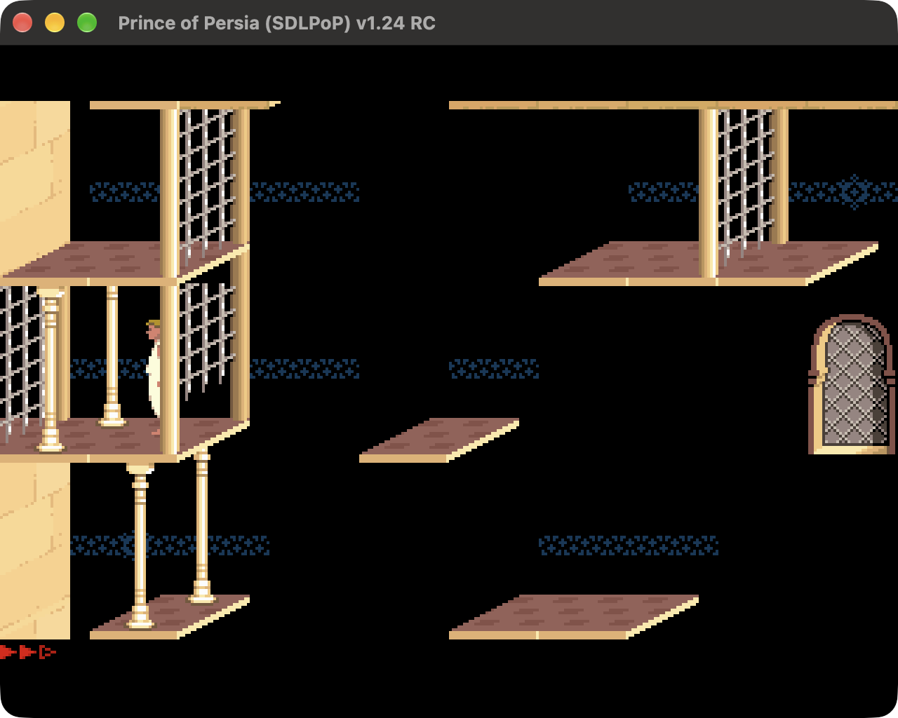

# Prince of Persia for macOS

A native, self-contained Apple Silicon port of DOS Prince of Persia (1990), powered by [SDLPoP](https://github.com/NagyD/SDLPoP)'s reverse-engineered engine and rendered with SDL2's **Metal** backend. No Rosetta, no DOSBox, no Homebrew runtime libraries.



## The headline feature: exact-state save & load

This port's save system snapshots *everything* — world, guards, RNG, timers, and even the exact audio state (OPL3 FM synthesis included) — and restores it byte-perfectly. Load a mid-fall, mid-song save and the game continues exactly as if nothing happened, with **no time penalty** and no restart of the music. Saves are atomic and validated; a corrupted or tampered file is rejected without touching your current session.

- Named save slots plus quicksave (F6) / quickload (F9)
- Native Game menu: Save ⌘S, Load ⌘O
- 10-slot in-game save UI
- Malformed saves are rejected safely — your world is never corrupted by a bad file

## Features

- Universal binary-quality native arm64 app, macOS 11+, ad-hoc signed
- Corrected 4:3 aspect, sharp nearest-neighbor scaling, Retina-aware
- Original digital sound and OPL3-emulated MIDI music, straight from the original DAT files
- Replays and screenshots saved to `~/Library/Application Support/local.princeofpersia.metal/`

## First launch: original game data

On first launch the app asks for your explicit consent, then downloads the original DOS game data (≈345 KiB, from [Archive.org](https://archive.org/details/PERSIA_VGA)), verifies it against a pinned SHA-256 hash, and installs it. The game assets remain copyrighted; this project distributes **no game content** — only the GPL-licensed code. You can delete the install at any time.

## Build

Requires macOS with Command Line Tools and CMake ≥ 3.24. SDL2 and SDL2_image are fetched and statically linked at build time.

```sh
cmake -S . -B build -G "Unix Makefiles" -DCMAKE_BUILD_TYPE=RelWithDebInfo -DCMAKE_OSX_ARCHITECTURES=arm64 -DCMAKE_OSX_DEPLOYMENT_TARGET=11.0
cmake --build build --parallel
open "build/Prince of Persia.app"
```

To run the test suite (needs installed game data):

```sh
POP_TEST_ASSETS="$HOME/Library/Application Support/local.princeofpersia.metal/GameData" ctest --test-dir build --output-on-failure
```

## How it works

The app embeds the SDLPoP engine (from the original DOS disassembly), renders through SDL2's Metal renderer, and layers on a consent-gated asset installer, a new `.popsave` snapshot format, and native macOS menus. The full design notes live in [`doc/PORTING_PLAN.md`](doc/PORTING_PLAN.md).

## Credits & license

Code is licensed **GPL-3.0-or-later** ([COPYING](COPYING)); SDLPoP is by NagyD and contributors — see [`doc/upstream-README.md`](doc/upstream-README.md) and [`doc/Readme.txt`](doc/Readme.txt). Prince of Persia is a trademark of its rights holders; this is an unofficial fan port.
